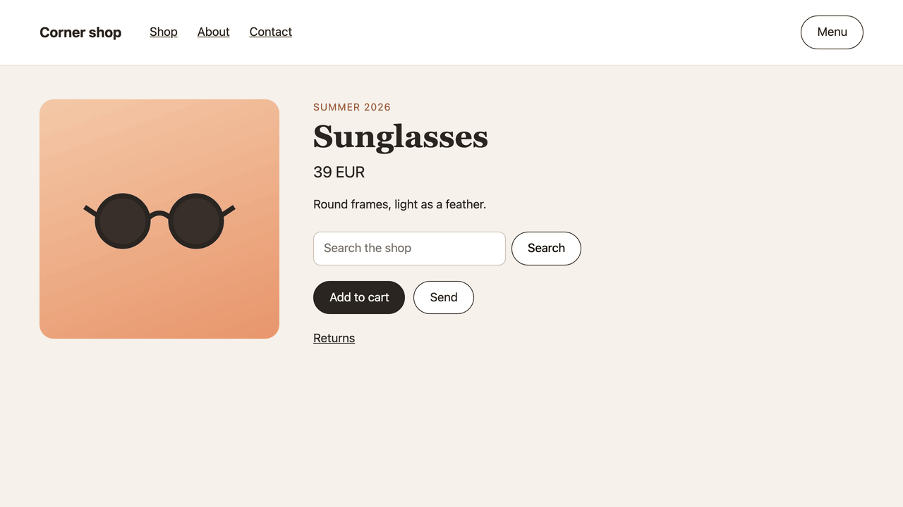

<p align="center"></p>

# Tab trail

One click shows the path the Tab key takes through any page, and marks in red what fails WCAG 2.2 AA.

[](https://www.npmjs.com/package/tab-trail)
[](https://github.com/matjazkorosec/tab-trail/actions/workflows/ci.yml)
[](LICENSE)

Some people only use the keyboard. If Tab skips your "Add to cart" button, they can't buy from you. If it skips "Send" on your contact form, they can't write to you. Even Lighthouse tells you to check this by hand. Tab trail checks it for you.

I built it to check every page of my own site with the keyboard. **[Try it on the live page](https://matjazkorosec.com/tools/tab-trail)**, it has 3 things broken on purpose.

## Install

### Bookmark

1. Open [matjazkorosec.com/tools/tab-trail](https://matjazkorosec.com/tools/tab-trail) and drag the Tab trail button to your bookmarks bar. Don't see the bookmarks bar? Press Ctrl+Shift+B, or Cmd+Shift+B on a Mac.
2. Open your site and click the bookmark.
3. Press Tab and follow the numbers, or press Play and it walks every stop for you. Click the bookmark again or the close button to close it.

Your bookmark keeps the version you dragged. To get new checks, delete it and drag the button again.

### Console

<!-- console:start -->
Copy [`dist/tab-trail.js`](https://raw.githubusercontent.com/matjazkorosec/tab-trail/v1.0.0/dist/tab-trail.js). On your site press F12, or Cmd+Option+I on a Mac (Cmd+Option+C in Safari), open Console and paste. If it asks, type allow pasting, press Enter, and paste again.
<!-- console:end -->

<!-- firefox:start -->
Firefox can't store a bookmark longer than 65,536 characters, and the Tab trail bookmark is 223,286. In Firefox, paste the script in the console instead.
<!-- firefox:end -->

### Playwright

```sh
npm i -D --save-exact tab-trail
```

The script is in `node_modules/tab-trail/dist/tab-trail.js`. The example below reads a copy saved in your repo instead; both work.

## What it lists in red

<!-- checks:start -->
1. **Missed spots** (WCAG 2.1.1 A): A red box marks something that looks clickable, like a box with a pointer cursor, a button role or a click handler in the HTML. The keyboard never gets there. [See it](https://matjazkorosec.com/tools/tab-trail#show-missed-spots)
2. **Hover menus** (WCAG 2.1.1 A, 2.4.7 AA): A menu that opens on mouse hover but never when Tab reaches it hides its links from keyboard users. Tab trail reads the page's CSS and marks each one with a red box. [See it](https://matjazkorosec.com/tools/tab-trail#show-hover-menus)
3. **Forced order** (WCAG 2.4.3 A): An element with tabindex="5" gets Tab before the rest of the page, wherever it sits. When that changes the order, it is listed in red: set it to 0 and move the element in the HTML instead. If it was first anyway, the Log only notes it. [See it](https://matjazkorosec.com/tools/tab-trail#show-forced-order)
4. **Hidden focus** (WCAG 2.4.11 AA): When Tab lands on something a sticky header, a cookie bar or a chat button covers completely, the panel lists it in red. Click it to scroll it into view. Fix it and Tab there again: it leaves the list. This check is new in WCAG 2.2 AA. [See it](https://matjazkorosec.com/tools/tab-trail#show-hidden-focus)
5. **Keyboard trap** (WCAG 2.1.2 A): When Tab and Shift+Tab both leave focus on the same spot, a keyboard user can't get out. The panel lists that stop in red, once, like "2: Message". A spot that keeps Tab but says how to leave, like a code editor, is not red. [See it](https://matjazkorosec.com/tools/tab-trail#show-keyboard-trap)
6. **Lost focus** (WCAG 2.4.3 A): When a popup or cookie bar closes, focus should go back to the button that opened it. If it drops to the top of the page instead, the panel lists it in red, like "2 → Start". [See it](https://matjazkorosec.com/tools/tab-trail#show-lost-focus)
7. **Out of order** (WCAG 2.4.3 A): Each time Tab jumps out of order, the panel lists the jump in red. A popup that blocks the page must get Tab first, or it is flagged too. [See it](https://matjazkorosec.com/tools/tab-trail#show-out-of-order)
<!-- checks:end -->

Each check in full: [docs/checks.md](docs/checks.md). Everything else it does: [docs/features.md](docs/features.md). Keys and how to read the trail: [docs/keys.md](docs/keys.md).

## For tests and AI agents

Copy for AI copies only the problems, each with its WCAG rule, what should happen, a CSS selector, the HTML, the React, Vue or Angular component that drew it (on a dev build), a fix hint and how to check the fix. Paste it into your coding AI and it knows where to look.

While Tab trail is open, the page has `window.__tabTrail`, so a test or an AI agent can run it with no clicks:

<!-- api:start -->
- `await window.__tabTrail.play({ ignore, delay })`: Walks every stop, or until it is paused, then gives back the report. Call it again to go on. ignore is a list of CSS selectors to leave out, like a part broken on purpose. delay is the wait at each stop, 400 ms if you leave it out. An ignore entry that isn't valid CSS makes it fail with an error.
- `window.__tabTrail.problems()`: Every open problem as data, never cut short: id (the same on every run), check, wcag, selector, html, component, fix, verify.
- `window.__tabTrail.report()`: The Copy for AI text.
- `window.__tabTrail.log()`: Every Log line as data: time, result, check, wcag, text, fixed, selector, stop.
- `window.__tabTrail.state()`: { walked, total, done, untested }. done is true once Play reached the end. untested names the checks that never ran, like Lost focus when no popup was opened, so a green test can tell a clean page from a check that was skipped.
- `window.__tabTrail.version`: "1.0.0"
- `window.__tabTrail.close()`: Closes it.
<!-- api:end -->

Full reference: [docs/api.md](docs/api.md).

### Playwright example

It fails when a check finds a problem, and attaches the whole report.

<!-- test:start -->
Save the script in your repo once, so every CI run uses the version you tested:

```sh
curl -o tests/tab-trail.js https://raw.githubusercontent.com/matjazkorosec/tab-trail/v1.0.0/dist/tab-trail.js
```

Then load it with `page.evaluate`, so a strict CSP or Trusted Types don't block it:

```ts
import { readFileSync } from "node:fs";
import { test, expect } from "@playwright/test";

const script = readFileSync("tests/tab-trail.js", "utf8");

test("Tab reaches everything", async ({ page }) => {
  test.setTimeout(300_000);
  await page.goto("http://localhost:5173/");
  await page.evaluate(script);
  const { total } = await page.evaluate(() => window.__tabTrail.state());
  for (let i = 0; i <= total; i++) await page.keyboard.press("Tab");
  for (let i = 0; i <= total; i++) await page.keyboard.press("Shift+Tab");
  const report = await page.evaluate(() => window.__tabTrail.play({ ignore: [".third-party-widget"] }));
  await test.info().attach("tab-trail-report.txt", { body: report, contentType: "text/plain" });
  const { done } = await page.evaluate(() => window.__tabTrail.state());
  const problems = await page.evaluate(() => window.__tabTrail.problems());
  expect(done).toBe(true);
  expect(problems.map((p) => `${p.check}: ${p.selector}`)).toEqual([]);
});

type Problem = { id: string; check: string; wcag: string | null; selector: string | null; html: string | null; component: string | null; fix: string; verify: string };
type Line = { time: string; result: string; check: string; wcag: string | null; text: string; fixed: boolean; selector: string | null; stop: number | null };

declare global {
  interface Window {
    __tabTrail: {
      version: string;
      play(options?: { ignore?: string[]; delay?: number }): Promise<string>;
      problems(): Problem[];
      report(): string;
      log(): Line[];
      state(): { walked: number; total: number; done: boolean };
      close(): void;
    };
  }
}
```
<!-- test:end -->

Already run axe in your tests? Keep it: axe reads the HTML, Tab trail walks the Tab key. Play moves focus itself, so it checks Missed spots, Hover menus, Forced order and Hidden focus. The Tab presses before it, once forward and once back through every stop, judge Out of order and Keyboard trap; Lost focus needs a popup opened and closed. Add the script once per page: running it again closes it. Play takes about half a second a stop, so 300_000 ms covers about 600 stops.

## What it does to your page

It reads the page and sends nothing: no network requests, no cookies, no local storage. It draws in 1 layer it adds to the page, inside its own shadow root, and closing it removes the layer. It only moves focus and scrolls, the way your Tab key would. Play never clicks.

Copy for AI copies the tag, id, classes, role, tabindex, state and ARIA of each element, a short bit of its text, and the nearest id and heading around it. Long numbers, emails and tokens are masked. Read it before you paste it.

## Limits

It's not a full audit. It is the keyboard part. What a person still checks by hand: [docs/limits.md](docs/limits.md). How it sits next to the tools you know: [docs/compared.md](docs/compared.md).

## Contributing

Bug and doc fixes can go straight to a pull request. For a new check, setting or panel change, open an issue first. The rules and the dev loop: [CONTRIBUTING.md](CONTRIBUTING.md). Found a bug? Press Copy log in the panel and paste it into a [bug report](https://github.com/matjazkorosec/tab-trail/issues/new/choose).

## License

[MIT](LICENSE), Copyright (c) 2026 Matjaž Korošec. Use it, change it and share it, at work too. Every copy keeps the license text at the top of the script.
